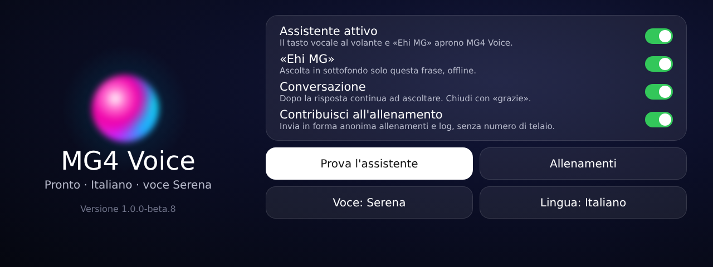
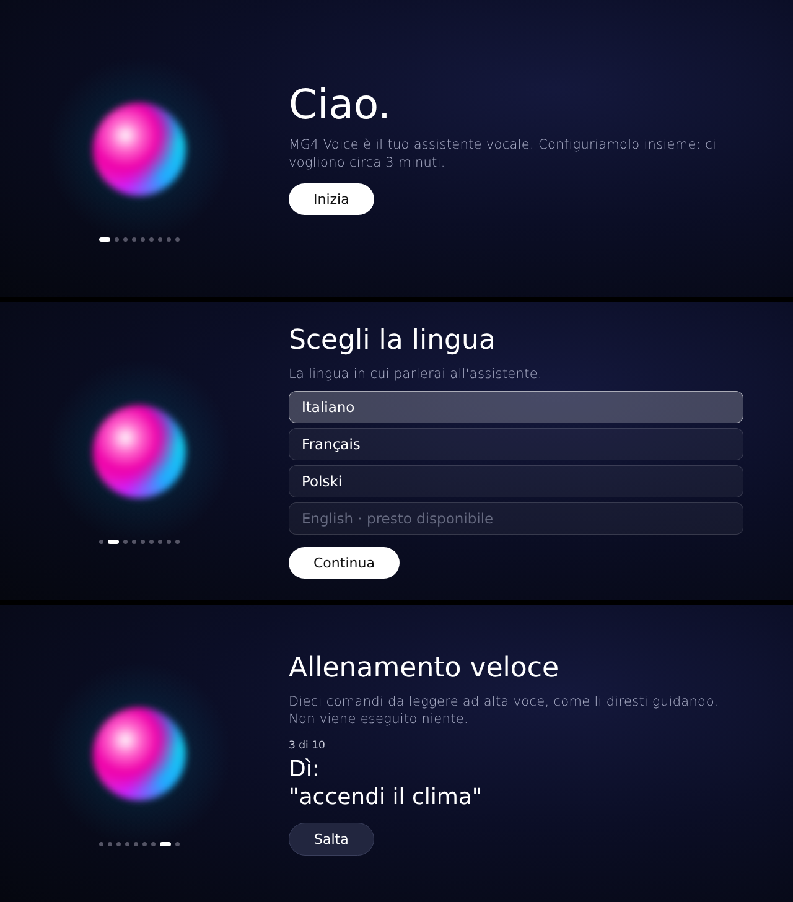

# MG4 Voice

<p align="center"></p>

<p align="center">
<b>Assistente vocale offline per l'infotainment MG4</b><br>
<i>Offline voice assistant for the MG4 infotainment</i>
</p>

<p align="center">
<a href="releases/MG4Voice-1.0.0-beta.13.apk"></a>
<a href="https://paypal.me/ErnestoMicco?locale.x=it_IT&country.x=IT"></a>

</p>

<p align="center">
🇮🇹 <a href="#italiano">Italiano</a> · 🇬🇧 <a href="#english">English</a> ·
<a href="#quale-versione-installare--which-version-should-i-install">Quale versione? / Which version?</a> ·
<a href="#versioni">Novità</a> / <a href="#changelog">What's new</a>
</p>

> 🧪 **VERSIONE BETA – supersperimentale, solo per prova.** Serve a capire se l'app funziona sulle auto reali e a
> raccogliere allenamento: **serve ancora tanto allenamento**. Può sbagliare comandi, comportarsi in modo strano o
> avere funzioni incomplete. Non è la versione stabile.
>
> 🧪 **BETA VERSION – super-experimental, for testing only.** It is meant to find out whether the app works on real
> cars and to collect training data: **it still needs a lot of training**. It may misunderstand commands, behave oddly
> or have unfinished features. It is not the stable version.

---

## Schermate / Screenshots

<table>
<tr>
<td width="50%" valign="top"><br>
<sub>MG4 Voice <b>in ascolto</b>, sopra la home · <i>MG4 Voice <b>listening</b>, over the home screen</i></sub></td>
<td width="50%" valign="top"><br>
<sub><b>Configurazione iniziale</b>: lingua, voce, microfono, "Ehi MG" · <i><b>First setup</b>: language, voice, microphone, "Hey MG"</i></sub></td>
</tr>
</table>

---

## Quale versione installare? / Which version should I install?

C'è **un solo APK** per tutti i software dell'infotainment MG4: **SWI68, SWI69, SWI132 e SWI133**. MG4 Voice
riconosce da solo il software dell'auto e usa i servizi giusti.

There is **one single APK** for every MG4 infotainment software: **SWI68, SWI69, SWI132 and SWI133**. MG4 Voice
detects the car's software by itself and uses the right services.

---

## Italiano

MG4 Voice prende il posto dell'assistente vocale originale, senza modificarlo. Si apre con il **tasto vocale al
volante** o dicendo **"Ehi MG"** / **"Ciao MG"**, capisce i comandi e li esegue sull'auto. Risponde a voce.

**Indice:** [Cosa fa](#cosa-fa) · [Installazione](#installazione) · [Aggiornamenti](#aggiornamenti) · [MG4 Store](#mg4-store) · [Tornare all'assistente originale](#tornare-allassistente-originale) · [Aiutaci ad allenarla](#aiutaci-ad-allenarla) · [Segnalare un problema](#segnalare-un-problema) · [Sostieni il progetto](#sostieni-il-progetto) · [Versioni](#versioni) · [Cosa arriva](#cosa-arriva)

### Cosa fa

- **Comandi sull'auto:** clima, temperatura, ventola, sbrinamento, sedili e volante riscaldati, volume, radio,
  musica, autonomia, batteria, telefono, finestrini, navigatore ("portami a…").
- **Funziona offline:** internet serve solo per scaricare lingua e voce la prima volta, e per gli aggiornamenti.
- **Lingue:** **italiano**, più **francese** e **polacco** in prova. Le altre lingue (inglese, spagnolo, tedesco,
  portoghese BR/PT e turco) arriveranno più avanti, sviluppate con l'aiuto di **madrelingua**.
- **Voce naturale scaricabile:** Serena per l'italiano, Jessica per il francese, Gosia per il polacco.
- **Capisce anche come si parla davvero:** "fa un freddo cane", "la musica è troppo alta", "il vetro è appannato"…
- **Musica più bassa mentre parli:** radio e musica scendono durante la conversazione e tornano come prima alla fine.
- **Android Auto e CarPlay:** con Android Auto attivo "Ehi MG" si mette in pausa e lascia microfono e tasto al
  volante all'assistente di Google. Con CarPlay o una scatola AI MG4 Voice resta attiva; chi usa Siri può accendere
  "Pausa con CarPlay e scatole AI" nelle impostazioni.
- **Frasi imparate:** nelle impostazioni c'è l'elenco delle frasi che l'assistente ha imparato, da cui puoi
  cancellarne una o tutte.

### Installazione

Si installa come una **normale app**. Scarica l'APK dalla cartella [`releases/`](releases/) (l'ultima beta) oppure
dalla pagina [Releases](../../releases).

#### Metodo 1 — Da chiavetta USB (senza computer)

1. Copia `MG4Voice-1.0.0-beta.13.apk` su una chiavetta USB formattata **FAT32** o **exFAT**.
2. Inserisci la chiavetta nell'auto, apri il file manager e tocca l'APK.
3. Se Android avvisa che non può installare app da questa fonte: tocca **Impostazioni**, attiva
   **Consenti da questa fonte** per il file manager e torna indietro.
4. Tocca **Installa**.

#### Metodo 2 — Con adb da computer

```bash
adb install -r -f MG4Voice-1.0.0-beta.13.apk
```

Al primo avvio parte la **configurazione** (circa 3 minuti, **ad auto ferma**): lingua, voce, microfono, "Ehi MG" e
un allenamento veloce.

MG4 Voice **disattiva l'assistente vocale originale** dell'auto, così il tasto al volante apre il nostro.

### Aggiornamenti

MG4 Voice si aggiorna da sola: scarica la nuova versione e, se il download si interrompe, riparte dal punto in cui
era arrivata. Lingue e voci sono pacchetti a parte, che si scaricano solo quando cambiano.

### MG4 Store

Ora c'è **MG4 Store** per scaricare e aggiornare tutte le nostre app MG4: il launcher, MG4 Clima, MG4 Voice,
MG4 Browser, MG4 Games e quelle che arriveranno. Si trova anche nel launcher MG4 (icona **Store**).
Repository: [ernestomicco2026-cell/store](https://github.com/ernestomicco2026-cell/store).

### Tornare all'assistente originale

**Prima di disinstallare MG4 Voice** spegni l'interruttore **"Assistente attivo"** nelle sue impostazioni:
l'assistente originale torna attivo. Poi disinstalla MG4 Voice da MG4 Store (cestino) o dalle impostazioni di Android.
L'assistente originale non viene mai modificato.

### Aiutaci ad allenarla

È una **beta**. Se nella configurazione scegli **"Contribuisco"**, gli allenamenti vengono inviati **in forma
anonima**: le frasi e brevi registrazioni dei comandi, niente numero di telaio, nomi della rubrica o numeri di
telefono. Con i dati di tutti costruiamo la versione stabile, e **ogni allenamento conta**: più la usi e la alleni,
più migliora. Si può disattivare nelle impostazioni.

### Segnalare un problema

Le segnalazioni si aprono nella sezione [Issues](../../issues): scrivi il software dell'auto (SWI68, SWI69, SWI132
o SWI133), la versione di MG4 Voice e la frase che hai detto.

MG4 Voice invia anche log tecnici **anonimi** per correggere i problemi: nel log restano solo i comandi riconosciuti,
mai le frasi dette in auto, i nomi della rubrica, i numeri di telefono o il nome del telefono collegato.

### Sostieni il progetto

MG4 Voice è **gratuito** per ora. Se ti è utile e ti va di contribuire alle ore passate a svilupparlo e provarlo
in auto, puoi lasciare un'offerta: è del tutto **volontaria** e **non c'è un importo minimo**, puoi donare quello che
vuoi. Anche una stella al repository o una segnalazione di un problema sono un aiuto prezioso. Grazie!

Anche solo **2 €** sono un aiuto prezioso per continuare a sviluppare e provare in auto le nuove versioni.

[](https://paypal.me/ErnestoMicco?locale.x=it_IT&country.x=IT)

### Versioni

Le note complete di ogni versione sono nella cartella [`releases/notes/`](releases/notes/).

#### 1.0.0-beta.13
- Risposte più rapide: quando hai finito di parlare l'assistente aspetta meno.
- "Vuoi aprire o chiudere il finestrino?": basta rispondere "apri" o "chiudi".
- "Il volume" detto da solo: l'assistente chiede se alzarlo o abbassarlo.
- Configurazione iniziale: se il microfono è ancora occupato subito dopo l'installazione, aspetta che si liberi.
- Francese: "la clim sur 23" imposta 23 gradi.

#### 1.0.0-beta.12
- Con una scatola CarPlay o AI collegata "Ehi MG" e il tasto al volante tornano a funzionare: la pausa vale solo per
  Android Auto (con Siri si accende "Pausa con CarPlay e scatole AI").
- "MG" da solo non scatta mai prima che tu abbia finito di parlare.
- Un aggiornamento che non si installa viene scaricato di nuovo.
- Il nome del telefono o della scatola collegata non finisce più nel log.

#### 1.0.0-beta.11
- "Ciao MG" / "Ehi MG" riconosciuto anche con una pausa tra le due parole; basta anche "MG" da solo (si può spegnere).
- La sfera compare subito.
- SWI68: radio e musica si abbassano davvero mentre parli.
- Comandi nuovi: "che ore sono", "freddo" o "caldo" da soli, "basta grazie", "addio".
- Nel log restano solo i comandi, non le frasi dette in auto.
- Se MG4 Launcher viene tolto, la home originale dell'auto si riaccende da sola.

#### 1.0.0-beta.10
- Con Android Auto attivo "Ehi MG" si mette in pausa e lascia il microfono al suo assistente.
- Musica al 40% circa mentre parli, poi torna com'era.
- Aggiornamenti che riprendono da dove si erano fermati; app più leggera (13,7 MB invece di 18,5).
- Nei log non finiscono più nomi della rubrica né numeri di telefono.

#### 1.0.0-beta.9
- Corretta la chiusura dell'app dopo ogni comando (beta.8).
- Avvisi in sovraimpressione per le correzioni importanti.

#### 1.0.0-beta.8
- Voce nuova Serena, una sola voce naturale per tutte le risposte.
- Francese (Jessica) e polacco (Gosia) in prova.
- Chiamate vere dal telefono collegato, con conferma del nome e del numero.
- Ascolto più lungo; "portami a…" apre il navigatore; elenco "Frasi imparate".

#### 1.0.0-beta.7
- Radio e musica si abbassano davvero quando parli; volume dell'auto anche su SWI69 e SWI132.
- Configurazione più robusta con il microfono occupato.

#### 1.0.0-beta.6
- "Ciao MG" riconosciuto anche con una piccola pausa; rubrica anche sulla SWI69.
- "Disattiva l'aria condizionata" ora spegne il clima; due comandi nella stessa frase.

#### 1.0.0-beta.5
- L'assistente originale viene disattivato: il tasto al volante apre sempre MG4 Voice (per riaverlo si spegne
  "Assistente attivo").

#### 1.0.0-beta.4
- Microfono occupato all'accensione: MG4 Voice riprova da sola; musica più bassa durante la conversazione.

#### 1.0.0-beta.3
- Correzioni dai primi test in auto: radio, sedili e volante, numeri da chiamare, microfono occupato.

#### 1.0.0-beta.2
- Prima beta: configurazione iniziale, italiano con voci scaricabili, aggiornamenti automatici.

### Cosa arriva

- **Passo 1 — prossime beta:** correzioni dai log e dagli allenamenti, più frasi capite.
- **Passo 2 — altre lingue:** inglese, spagnolo, tedesco, portoghese e turco, con l'aiuto di madrelingua.
- **Passo 3 — versione stabile**, quando l'allenamento sarà sufficiente.

Molte idee arrivano dalle segnalazioni (issue) e dagli allenamenti degli utenti: grazie!

⚠️ **Avviso:** è un'app non ufficiale, non legata a MG/SAIC. La usi a tuo rischio: non fare la configurazione mentre
guidi.

---

## English

MG4 Voice replaces the original voice assistant, without modifying it. Open it with the **steering-wheel voice
button** or by saying **"Hey MG"** / **"Ciao MG"**. It understands commands and runs them on the car. It answers by
voice.

**Contents:** [Features](#features) · [Installation](#installation) · [Updates](#updates) · [MG4 Store](#mg4-store-1) · [Going back to the original assistant](#going-back-to-the-original-assistant) · [Help us train it](#help-us-train-it) · [Reporting a problem](#reporting-a-problem) · [Support the project](#support-the-project) · [Changelog](#changelog) · [What's coming](#whats-coming)

### Features

- **Car commands:** climate, temperature, fan, defrost, heated seats and wheel, volume, radio, music, range, battery,
  phone, windows, navigation ("take me to…").
- **Works offline:** internet is only needed to download the language and voice the first time, and for updates.
- **Languages:** **Italian**, plus **French** and **Polish** in testing. The other languages (English, Spanish,
  German, Portuguese BR/PT and Turkish) will come later, developed with the help of **native speakers**.
- **Natural downloadable voice:** Serena for Italian, Jessica for French, Gosia for Polish.
- **It understands how people really talk:** "fa un freddo cane", "la musica è troppo alta"…
- **Music goes down while you talk:** radio and music lower during the conversation and come back at the end.
- **Android Auto and CarPlay:** while Android Auto is active, "Hey MG" pauses and leaves the microphone and the
  steering-wheel button to Google's assistant. With CarPlay or an AI box MG4 Voice stays on; if you use Siri, turn on
  "Pause with CarPlay and AI boxes" in the settings.
- **Learned phrases:** the settings list the phrases the assistant has learned; you can delete one or all of them.

### Installation

It installs like a **normal app**. Download the APK from the [`releases/`](releases/) folder (the latest beta) or
from the [Releases](../../releases) page.

#### Method 1 — From a USB stick (no computer)

1. Copy `MG4Voice-1.0.0-beta.13.apk` to a USB stick formatted **FAT32** or **exFAT**.
2. Plug the stick into the car, open the file manager and tap the APK.
3. If Android says it can't install apps from this source: tap **Settings**, enable **Allow from this source**
   for the file manager and go back.
4. Tap **Install**.

#### Method 2 — With adb from a computer

```bash
adb install -r -f MG4Voice-1.0.0-beta.13.apk
```

On first launch the **setup** starts (about 3 minutes, **while parked**): language, voice, microphone, "Hey MG" and a
quick training.

MG4 Voice **turns off the car's original voice assistant**, so the steering-wheel button opens ours.

### Updates

MG4 Voice updates itself: it downloads the new version and, if the download stops, resumes where it left off.
Languages and voices are separate packs, downloaded only when they change.

### MG4 Store

There is now **MG4 Store** to download and update all our MG4 apps: the launcher, MG4 Clima, MG4 Voice, MG4 Browser,
MG4 Games and the ones still to come. You also find it in the MG4 launcher (**Store** icon).
Repository: [ernestomicco2026-cell/store](https://github.com/ernestomicco2026-cell/store).

### Going back to the original assistant

**Before uninstalling MG4 Voice**, switch off **"Assistant on"** in its settings: the original assistant comes back.
Then uninstall MG4 Voice from MG4 Store (bin) or from the Android settings. The original assistant is never modified.

### Help us train it

It's a **beta**. If you choose **"I'll help"** during setup, training data is sent **anonymously**: phrases and short
command recordings, no VIN, contact names or phone numbers. With everyone's data we build the stable version, and
**every training session counts**. You can turn it off in the settings.

### Reporting a problem

Reports go in the [Issues](../../issues) section: write the car's software (SWI68, SWI69, SWI132 or SWI133), the
MG4 Voice version and the phrase you said.

MG4 Voice also sends **anonymous** technical logs to fix problems: only the recognised commands stay in the log, never
what people say in the car, contact names, phone numbers or the name of the connected phone.

### Support the project

MG4 Voice is **free** for now. If you find it useful and would like to contribute to the hours spent developing it and
testing it in the car, you can leave a donation: it's completely **voluntary** and **there is no minimum amount**, you
can give whatever you like. A star on the repository or a bug report help a lot too. Thank you!

Even just **€2** is a great help to keep developing and testing new versions in the car.

[](https://paypal.me/ErnestoMicco?locale.x=it_IT&country.x=IT)

### Changelog

The full notes of every version are in the [`releases/notes/`](releases/notes/) folder.

#### 1.0.0-beta.13
- Faster answers: once you stop talking the assistant waits less.
- "Do you want to open or close the window?": just answer "open" or "close".
- "Volume" on its own: the assistant asks whether to turn it up or down.
- First setup: if the microphone is still busy right after installing, it waits for it.
- French: "la clim sur 23" sets 23 degrees.

#### 1.0.0-beta.12
- With a CarPlay or AI box connected, "Hey MG" and the steering-wheel button work again: the pause applies only to
  Android Auto (with Siri, turn on "Pause with CarPlay and AI boxes").
- "MG" on its own never triggers before you have finished talking.
- An update that does not install is downloaded again.
- The name of the connected phone or box no longer ends up in the log.

#### 1.0.0-beta.11
- "Ciao MG" / "Hey MG" recognised even with a pause between the two words; "MG" alone works too (can be turned off).
- The sphere appears right away.
- SWI68: radio and music really go down while you talk.
- New commands: "what time is it", "cold" or "hot" on their own, "that's all thanks", "goodbye".
- Only commands stay in the log, not what people say in the car.
- If MG4 Launcher is removed, the car's original home turns back on by itself.

#### 1.0.0-beta.10
- While Android Auto is active, "Hey MG" pauses and leaves the microphone to its assistant.
- Music at about 40% while you talk, then back as it was.
- Updates resume where they stopped; lighter app (13.7 MB instead of 18.5).
- Contact names and phone numbers no longer end up in the logs.

#### 1.0.0-beta.9
- Fixed the app closing after every command (beta.8).
- On-screen notices for important fixes.

#### 1.0.0-beta.8
- New voice Serena, one natural voice for every answer.
- French (Jessica) and Polish (Gosia) in testing.
- Real calls from the connected phone, with name and number confirmation.
- Longer listening; "take me to…" opens the navigator; "Learned phrases" list.

#### 1.0.0-beta.7
- Radio and music really go down when you talk; car volume on SWI69 and SWI132 too.
- More robust setup when the microphone is busy.

#### 1.0.0-beta.6
- "Ciao MG" recognised even with a short pause; contacts on SWI69 too.
- "Turn off the air conditioning" now switches the climate off; two commands in the same sentence.

#### 1.0.0-beta.5
- The original assistant is turned off: the steering-wheel button always opens MG4 Voice (switch off
  "Assistant on" to get it back).

#### 1.0.0-beta.4
- Microphone busy at power-on: MG4 Voice tries again by itself; music lower during the conversation.

#### 1.0.0-beta.3
- Fixes from the first tests in the car: radio, seats and wheel, numbers to call, busy microphone.

#### 1.0.0-beta.2
- First beta: initial setup, Italian with downloadable voices, automatic updates.

### What's coming

- **Step 1 — next betas:** fixes from the logs and the training data, more phrases understood.
- **Step 2 — more languages:** English, Spanish, German, Portuguese and Turkish, with the help of native speakers.
- **Step 3 — stable version**, once there is enough training.

Many ideas come from users' reports (issues) and training data: thank you!

⚠️ **Disclaimer:** unofficial app, not affiliated with MG/SAIC. Use at your own risk; never run the setup while driving.
