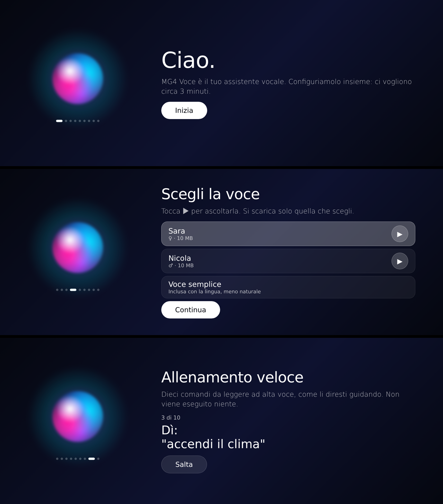

# MG4 Voice

**🇮🇹 Assistente vocale offline per l'infotainment MG4 · 🇬🇧 Offline voice assistant for the MG4 infotainment**

> 🧪 **VERSIONE BETA (1.0.0-beta.2) – supersperimentale, solo per prova.** Serve a capire se l'app funziona sulle
> auto reali e a raccogliere allenamento: **serve ancora tanto allenamento**. Può sbagliare comandi, comportarsi in
> modo strano o avere funzioni incomplete. Non è la versione stabile.
>
> 🧪 **BETA VERSION (1.0.0-beta.2) – super-experimental, for testing only.** It is meant to find out whether the app
> works on real cars and to collect training data: **it still needs a lot of training**. It may misunderstand
> commands, behave oddly or have unfinished features. It is not the stable version.



---

## 🇮🇹 Italiano

MG4 Voice prende il posto dell'assistente originale (senza modificarlo). Si apre con il **tasto vocale al volante**
o dicendo **"Ehi MG"**, capisce i comandi e li esegue sull'auto: clima, temperatura, ventola, sbrinamento, sedili e
volante riscaldati, volume, radio, musica, autonomia, batteria, telefono, finestrini. Risponde a voce.
**Funziona offline**: internet serve solo per scaricare lingua e voce la prima volta, e per gli aggiornamenti.

- **Versioni:** SWI68, SWI69, SWI132, SWI133. Un solo APK, che riconosce il software da solo.
- **Lingue:** per ora **solo italiano**. Le altre lingue (inglese, francese, spagnolo, tedesco, portoghese BR/PT,
  turco e polacco) arriveranno più avanti, sviluppate con l'aiuto di **madrelingua**.
- **Voci naturali scaricabili:** Sara e Nicola.
- **Capisce anche come si parla davvero:** "fa un freddo cane", "la musica è troppo alta", "il vetro è appannato"…
- **Aggiornamenti automatici.**

### Installazione
```
adb install -r -f MG4-Voice-1.0.0-beta.x.apk
```
Al primo avvio parte la **configurazione** (circa 3 minuti, ad auto ferma): lingua, voce, microfono, "Ehi MG" e un
allenamento veloce.

### Aiutaci ad allenarla
È una **beta**. Se nella configurazione scegli **"Contribuisco"**, gli allenamenti vengono inviati **in forma
anonima**: le frasi e brevi registrazioni dei comandi, niente numero di telaio. Con i dati di tutti costruiamo la
versione stabile, e **ogni allenamento conta**: più la usi e la alleni, più migliora. Si può disattivare nelle impostazioni.

⚠️ **Avviso:** è un'app non ufficiale, non legata a MG/SAIC. La usi a tuo rischio: non fare la configurazione mentre
guidi.

---

## 🇬🇧 English

MG4 Voice replaces the original voice assistant (without modifying it). Open it with the **steering-wheel voice
button** or by saying **"Hey MG"**. It understands commands and runs them on the car: climate, temperature, fan,
defrost, heated seats and wheel, volume, radio, music, range, battery, phone, windows. It answers by voice.
**Works offline**: internet is only needed to download the language and voice the first time, and for updates.

- **Versions:** SWI68, SWI69, SWI132, SWI133. One single APK, which detects the software by itself.
- **Languages:** for now **Italian only**. The other languages (English, French, Spanish, German, Portuguese BR/PT,
  Turkish and Polish) will come later, developed with the help of **native speakers**.
- **Automatic updates.**

### Install (beta)
`adb install -r -f MG4-Voice-1.0.0-beta.x.apk`. On first launch a short **setup** starts (about 3 minutes, while
parked).

### Help us train it
If you choose **"I'll help"**, training data is sent **anonymously** (phrases and short command recordings, no VIN).
You can turn it off in the settings.

⚠️ **Disclaimer:** unofficial app, not affiliated with MG/SAIC. Use at your own risk; never run the setup while
driving.
